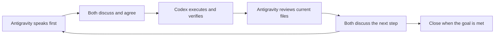

# GitHub Antigravity Collaboration

**Antigravity speaks first. Codex executes. Both agree on the plan. Antigravity reviews the result.**

A reusable collaboration skill and a small Python supervisor for working with real Antigravity and Codex sessions. Antigravity can independently read the authorized original workspace, rather than receiving a file bundle selected by Codex.

The first response can be a diagnosis, explanation, recommendation, or proposal. It does **not** have to contain a new research idea.



## What is included

- A project-independent [Codex skill](skills/antigravity-codex-collaboration/SKILL.md) defining responsibilities, agreement, execution, review, and closure.
- [English conversation templates](skills/antigravity-codex-collaboration/references/dialogue-prompts.md) for each stage.
- A [CLI supervisor](skills/antigravity-codex-collaboration/scripts/run_agy.py) that preserves responses and distinguishes useful model output from process termination.
- Eleven local regression tests, including a successful response followed by a hanging process, denied actions with an empty response, incorrect conversation identity, and preservation of unrelated processes.
- GitHub Actions checks on Windows and Linux, without provider credentials or live model calls.

This is a skill-driven workflow, not an unattended multi-agent scheduler. Codex orchestrates the stages; the Python script supervises one CLI invocation at a time.

## Getting started

You need Python 3.10 or newer, Codex, and an installed, authenticated Antigravity CLI (`agy`). The supervisor uses only the Python standard library. It does not install providers, change models, or modify global permissions.

1. Clone this repository.
2. Ask Codex to read `skills/antigravity-codex-collaboration/SKILL.md` and apply it to your project. Alternatively, copy that entire skill directory into your existing skill location.
3. Specify the project workspace, the task, and whether Antigravity may read the whole workspace. The [project instruction example](examples/project-instructions.md) records this choice for future rounds.
4. Let Antigravity speak first. Codex then discusses the answer, agrees on any execution plan, performs the work, and requests an independent review.

Example request:

> Use the Antigravity-Codex collaboration skill. Antigravity may independently read this entire project workspace and should speak first about the current question. Discuss a shared plan, let Codex execute it, and have Antigravity review the latest files. Continue until the agreed task is complete. Exclude credentials, secrets, and unrelated personal data.

Whole-workspace access means that Antigravity can choose its own evidence. It does not mean every file must be read on every turn. Workspace content read by the CLI may be processed by its configured model service; access remains subject to the user's authorization and existing host/CLI controls.

## Run one Antigravity turn

The command below demonstrates the transport, not the entire collaboration loop. Run it from the project you have authorized Antigravity to inspect, using a new output directory for each invocation.

### PowerShell

```powershell
$collaborationRunner = 'C:\path\to\github-antigravity-collaboration\skills\antigravity-codex-collaboration\scripts\run_agy.py'
$workspacePath = (Get-Location).Path
$agyPath = Join-Path $HOME '.gemini\bin\agy.exe'

@'
You speak first. Independently read the authorized current workspace and explain
its current architecture and the most important unresolved question.
Use only existing permitted native file-reading tools such as read_file.
Do not run shell commands, modify files, change permissions, or read secrets.
List the evidence you actually inspected. Do not claim Codex has agreed yet.
'@ | python -X utf8 $collaborationRunner `
  --agy $agyPath `
  --workspace $workspacePath `
  --output-dir (Join-Path $workspacePath '.antigravity-runs/01-opening')

$runnerExitCode = $LASTEXITCODE
```

### POSIX shell

```sh
python3 /path/to/github-antigravity-collaboration/skills/antigravity-codex-collaboration/scripts/run_agy.py \
  --agy "$(command -v agy)" \
  --workspace "$PWD" \
  --output-dir "$PWD/.antigravity-runs/01-opening" <<'PROMPT'
You speak first. Independently read the authorized current workspace and explain
its current architecture and the most important unresolved question.
Use only existing permitted native file-reading tools such as read_file.
Do not run shell commands, modify files, change permissions, or read secrets.
List the evidence you actually inspected. Do not claim Codex has agreed yet.
PROMPT
```

Continue a discussion with `--conversation <conversation_id>` from its actual response, and a fresh output directory. For independent review, omit `--conversation` and explicitly request review of the latest workspace files. See the [CLI reference](skills/antigravity-codex-collaboration/references/cli.md).

## Results and automatic cleanup

Each invocation retains `stdout.json`, `stderr.log`, and `process.json` in its output directory. Treat these as private project artifacts; they can contain model responses and local paths. Keep the run directory out of your project commits.

| Outcome | Supervisor exit code | Meaning |
|---|---:|---|
| `COMPLETED` | 0 | Nonempty SUCCESS response and natural CLI exit 0. |
| `RESULT_RECEIVED_PROCESS_TERMINATED` | 2 | A response was retained, but the CLI needed cleanup after the exit grace period. Inspect the response; do not rerun it automatically. |
| `PERMISSION_DENIED` | 3 | The CLI reported denied actions, even if its envelope said SUCCESS. |
| `INVALID_RESULT`, `MODEL_ERROR`, `PROCESS_ERROR` | 3 | Output, provider status, or process exit was not acceptable. |
| `RUNNER_ERROR`, `CLEANUP_FAILED` | 4 | The supervisor encountered an error; cleanup failure can leave a child alive. |
| `TIMED_OUT` | 124 | The overall deadline expired. Partial output remains available. |
| `CANCELLED` | 130 | The supervisor received a keyboard interruption. |

The default exit grace is five seconds; the overall deadline is 600 seconds. Cleanup targets only the child held by the supervisor's process handle, never processes selected by name. It does not promise to terminate an arbitrary descendant process tree or recover from forcible termination of the supervisor itself.

An empty SUCCESS with `denied_actions` is a failed turn, not an agreement. Likewise, CLI SUCCESS is not a review PASS. Read the actual response before advancing the workflow.

The script mitigates a CLI lifecycle problem; it does not fix the provider CLI's internal reason for hanging. Real-provider workflow checks were performed on Windows with Antigravity CLI 1.5.16. The automated regression suite exercises the supervisor with local synthetic children, not the provider service.

## Tests

```sh
python -m unittest discover -s skills/antigravity-codex-collaboration/scripts -p "test_*.py" -v
```

No login, model calls, or network connection is needed for this suite. See [CONTRIBUTING.md](CONTRIBUTING.md) for change expectations.

## Relationship to Black Gravity

This project was inspired by [Zythenth/black-gravity](https://github.com/Zythenth/black-gravity). It provides a collaboration protocol and a direct-CLI lifecycle helper; it does not include the Black Gravity server, vendor its distribution, or claim compatibility with every bridge version.

For an existing Black Gravity connection, see the [optional bridge notes](skills/antigravity-codex-collaboration/references/black-gravity.md). Keep isolated copies and original-workspace reads distinct when checking review freshness.

This is an independent project, not an official OpenAI, Google, or Black Gravity product.

## License

[MIT](LICENSE).
